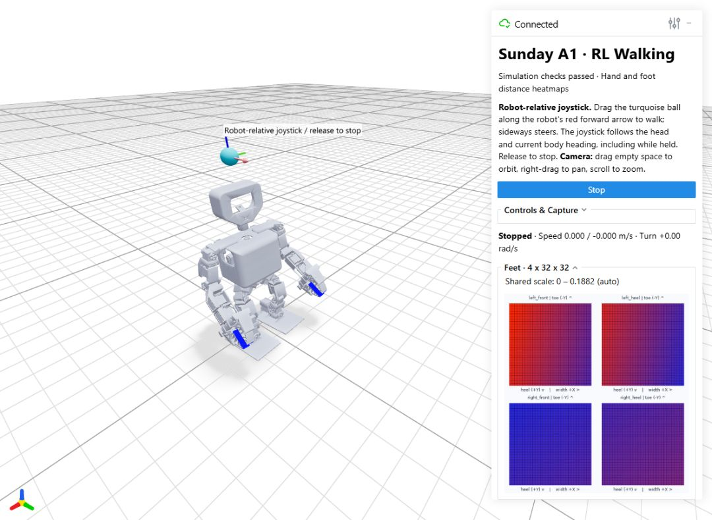

# Week 4 — Sunday A1 reinforcement learning walking

Whole-body PPO locomotion in MuJoCo/mjlab, with a robot-relative spring joystick and the eight hand/foot distance heatmaps carried over from Week 3.



The selected **R25-300** policy passed the documented flat-ground simulation checks. Training stopped after saving update 336. This release includes the accepted checkpoint, its frozen training source and dynamics, the current viewer, numerical evidence, and four front/side control recordings.

## Run the demo

Use a compatible **Python 3.11 environment with an NVIDIA GPU**. The tested package versions are in [code/requirements.txt](code/requirements.txt). Runtime physics and policy inference use native MuJoCo and CPU; initializing the mjlab environment and distance sensors still requires the CUDA stack. The launcher does not install or update packages.

From an activated environment:

```powershell
python code/run_demo.py --check
python code/run_demo.py
```

On Windows, activate that environment and double-click **start_demo.bat**, or set `WEEK4_PYTHON` to its `python.exe`. On Linux, run `bash start_demo.sh` from that environment. Wait for `WEB_DEMO_READY`, then open [the local control page](http://127.0.0.1:8086/).

The first launch may spend a few minutes compiling Warp kernels. A running viewer on the same port can be avoided with `python code/run_demo.py --port 8087`.

## Controls

- Hold and drag the turquoise ball above the head. The red arrow marks the robot's **current forward direction**; sideways deflection controls left/right yaw. Larger deflection requests faster motion.
- The joystick base follows the head and its axes follow body yaw continuously, including while held. New pointer motion uses the current body frame and perspective at the handle. Holding the pointer still retains the same body-relative command.
- Release to recenter and request zero velocity. The learned controller then brakes. **Stop** also clears the command.
- Drag empty space to orbit the camera, right-drag to pan, and scroll to zoom. **Controls & Capture** contains Reset camera view, optional position follow, episode reset, pause, and Save heatmaps.

| Published command | Limit | Measured example |
| --- | ---: | ---: |
| Forward | 0.12 m/s | Approximately 0.0944 m/s average |
| Reverse | -0.06 m/s | Approximately -0.0425 m/s over a complete gait cycle |
| Left/right yaw | +/-0.25 rad/s | Approximately +0.247 / -0.231 rad/s in place |

These are simulated results. The wider experimental envelope of 0.15 m/s and +/-0.4 rad/s was not accepted for this release.

## Evidence and reports

| Item | What to inspect |
| --- | --- |
| [Acceptance report](docs/Acceptance_Report.md) | 1,200 command sequences, 100 cycle-aware joystick trials, gait measurements, criteria revisions, and limitations |
| [Training plan](docs/Training_Plan.md) | Initial rewards, termination conditions, curriculum, sensing, and arm-control design; clearly separated from final settings |
| [Training history](docs/Training_History.md) | R1–R25 decisions and failed approaches, including the withdrawn early gait verdict |
| [Model and hardware review](docs/Model_and_Hardware.md) | Measured mass budget, CAD limits/axes/zeros, motor assumptions, and unresolved hardware data |
| [Interaction implementation](docs/Interaction_Update.md) | Body-relative input, continuous head tracking, camera control, and regression scope |
| [Reproduction guide](docs/Reproducibility.md) | Environment, evaluation commands, hashes, source provenance, and archive scope |
| [Accepted manifest](config/accepted_policy.json) | Checkpoint identity and exact evidence paths |
| [Results index](results/README.md) | Numerical reports, raw joystick trace, training curve, heatmaps, and videos |

Recordings: [speed changes, stop and restart](results/videos/control_r25_candidate300_responsive_responsive_speed_stop.mp4), [walking turns](results/videos/control_r25_candidate300_responsive_responsive_turns.mp4), [in-place turns](results/videos/control_r25_candidate300_responsive_responsive_in_place.mp4), and [reverse and stop](results/videos/control_r25_candidate300_responsive_responsive_backstep.mp4).

## Model and sensing scope

The simulated mass budget is **2.84 kg**, including a **0.70 kg root**. The actor controls 22 joints: 12 leg and 10 arm/wrist joints. Fingers and head remain at reference targets. The free base is not driven; joint actuators and contact dynamics produce the motion. Simulation velocity feedback is an actor input, so hardware deployment will require a velocity estimator.

The four foot arrays (32 x 32 each) and four hand arrays (12 x 32 each) retain Week 3's distance response, geometry, orientation, and coefficients. They are **uncalibrated distance heatmaps**, not force or pressure measurements. Saved contact-force metrics come separately from the physics solver.

## Repository layout

```text
Week4/
  README.md                  # Entry point and release scope
  start_demo.bat/.sh          # Portable environment-based launchers
  code/                      # Current implementation and frozen mjlab source
  config/                    # Acceptance and model assumptions
  docs/                      # English technical reports and archive inventory
  model/                     # Floating-base MJCF, references, and 28 meshes
  policies/                  # Accepted weights, source, and dynamics snapshot
  research/                  # Derived model/CAD audits and public references
  results/                   # Selected evidence and historical run metadata
```

Intermediate checkpoints, bulk control trajectories, caches, original Word/CAD files, and third-party repository checkouts remain in the local research archive. [Local_Archive_Index.json](docs/Local_Archive_Index.json) lists those omissions. Publication changes to paths and report language are documented in [Publication_Record.json](docs/Publication_Record.json).

## References

[mjlab](https://github.com/mujocolab/mjlab), [Open Duck Mini](https://github.com/apirrone/Open_Duck_Mini), [Open Duck Playground](https://github.com/apirrone/Open_Duck_Playground), and [Vibe Robotics SDK](https://github.com/viberobotics/vibe_robotics_sdk). See [the reference notes](research/README.md) for how each informed the work.
